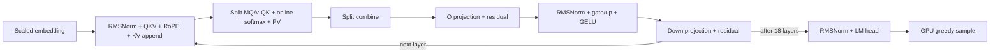

# Complete native Gemma-2B on Megakernels

Original **google/gemma-2b**, BF16, batch size one, one NVIDIA B200. The entire
model forward pass runs in the upstream `megakernel::mk` instruction VM, using
its controller, page allocator, asynchronous TMA loader, consumer, storer, and
shared-semaphore instruction pipeline. There are no generic operation adapters,
cooperative launches, grid barriers, or framework model operators in the native
execution path. Both native prefill and decode are available.

## Fused operator graph



One VM launch executes all **111 stages** per token (six fused stages per layer,
plus embedding, normalized LM head, and sampling). There are 1,044 producer
counters in the 512-position benchmark configuration, versus 44,514 producer
flags in the earlier unfused port. The default 8192-position configuration uses
16 attention splits and 2,772 producer counters.

- QKV weight tiles pair dimensions 128 apart, letting the storer apply Gemma's
  non-interleaved RoPE and append K/V without intermediate QKV or RoPE stages.
- Normalization uses Gemma's `1 + weight` semantics and BF16 activation rounding.
  The normalized activation remains in the consumer's registers.
- Gate/up weights are interleaved by output tile. The storer computes exact
  GELU and gating without global gate/up intermediate tensors.
- Attention double-buffers 32-by-256 K/V tiles through TMA pages, uses BF16
  tensor-core QK and PV with FP32 accumulation and online softmax, then combines
  splits stably. Every tile fits one allocator page; empty splits release pages.
- Dense projections use the upstream three-stage TMA matvec ring. The down
  projection streams eight 2048-element chunks, sums FP32 partials, and fuses
  the residual addition. O projection and final normalization are fused too.
- Acquire/release counters track heads, attention splits, and MLP input chunks.
  Static instruction streams are assigned by estimated work per SM. Producers
  can overlap successors without all CTAs meeting at an operation boundary.

The native binary contains HMMA and TMA-load instructions; disassembly counts
are saved in `results/fused-instruction-evidence.json`. Small output tiles use
coalesced stores from the native storer rather than separate CUDA kernels.

## Run entirely natively

```bash
cd /workspace/Megakernels/gemma
make
HF_HUB_ENABLE_HF_TRANSFER=0 /workspace/mirage/.venv/bin/python generate.py \
  --prompt 'The solar system contains eight planets. The largest planet is' \
  --tokens 64
```

`GemmaDecode.prefill(token_ids)` runs each prompt token through the fused VM;
`step()` performs one subsequent decode step. Native prefill is **token-by-token**,
not an optimized batched prefill kernel. The validated 8192-token native prefill
run took about 20 seconds. The model is fully native, but long-prompt prefill
throughput is not a performance advantage over batched engines.

Weights and tokenization use Hugging Face, and Python manages CUDA buffers and
launches. No Transformers forward call is needed for native model execution.
`load_cache()` also accepts a framework KV cache for isolated decode comparisons.
Validation patches framework forward to raise during native prefill, including
an entire 8192-token prompt.

## Measured decode performance

2026-10-15, one B200, batch one, identical pretrained BF16 weights and prompt IDs,
greedy generation, 128 output tokens with EOS ignored. Timing covers the final
**127 decode tokens**, excluding prefill, first output token, cache transfer,
compilation, and two warmups. Median of five measured requests:

| Implementation | Decode time/token | Decode tokens/s |
|---|---:|---:|
| Complete fused native Gemma | 1.825 ms | 548.03 |
| vLLM, refreshed | 2.247 ms | 445.05 |

**1.23× the measured vLLM decode throughput** on this workload. All 128 output
IDs match. vLLM request timings varied (264.65–294.03 ms for 127 decode tokens),
while the native run measured 231.73–231.80 ms. This is a short-context decode
comparison, not an end-to-end serving or native-prefill speedup claim.

Alternating requests in the same process separately verify:

| Baseline commit | Baseline ms/token | Fused ms/token | Speedup |
|---|---:|---:|---:|
| `08e198d`, unfused native port | 2.562 | 1.834 | 1.40× |
| `4a404a0`, optimized cooperative prototype | 2.099 | 1.836 | 1.14× |

The paired tests use 1024-position caches (eight splits); the main vLLM comparison
uses 512-position caches (four splits). Native timing is synchronized wall time,
including output-token copies. vLLM uses engine first/last-token timestamps;
full request wall times are also saved. vLLM compilation, FlashInfer attention,
and CUDA graphs are enabled; prefix caching is disabled. Software stack and
instrumentation differences remain limitations.

## Validation and reproducibility

- Exact 128-token agreement with vLLM on the benchmark prompt.
- Twelve teacher-forced next-token checks match Transformers.
- Native prefill on three prompts passes with framework forward disabled.
- Real-cache checks at positions 31, 32, 127, 128, 511, 1023, 2047, 4095, and
  8191 match the reference next token (minimum cosine about 0.999982).
- Full 8192-token native prefill matches the reference next token, cosine
  0.999997, and passes every stage/counter invariant at generation 8192.
- Repeated decoding verifies every stage arrival and producer counter; KV
  overflow is rejected. The original shared VM and Llama math are preserved.

These are numerical and functional checks, not a comprehensive accuracy eval.
The pretrained base model can generate incorrect facts.

```bash
# Full native model/cache/context checks:
HF_HUB_ENABLE_HF_TRANSFER=0 /workspace/mirage/.venv/bin/python validate_fused.py
# Main decode benchmark (framework-prefilled cache isolates decode):
HF_HUB_ENABLE_HF_TRANSFER=0 /workspace/mirage/.venv/bin/python bench.py
PATH=/workspace/Megakernels/local/vllm-venv/bin:$PATH HF_HUB_OFFLINE=1 \
  /workspace/Megakernels/local/vllm-venv/bin/python bench_vllm.py
# Same-process historical comparisons (baseline code rebuilt from Git):
HF_HUB_ENABLE_HF_TRANSFER=0 /workspace/mirage/.venv/bin/python verify_optimization.py
HF_HUB_ENABLE_HF_TRANSFER=0 /workspace/mirage/.venv/bin/python verify_optimization.py --baseline 4a404a0
# Separate instrumented VM build:
HF_HUB_ENABLE_HF_TRANSFER=0 /workspace/mirage/.venv/bin/python profile_stages.py
```

Run GPU jobs sequentially. Build: CUDA 12.8, `sm_100a`, this checkout's
ThunderKittens and native VM headers. Runtime: Python 3.12, PyTorch 2.8.0+cu128,
Transformers 4.57.1 in the existing Mirage venv. vLLM uses its existing Megakernels
venv (vLLM 0.31.0, PyTorch 2.13.0+cu130). No package changes were needed.
Cached checkpoint revision: `9cf48e52b224239de00d483ec8eb84fb8d0f3a3a`.

Source: `fused.cuh`, `attention.cuh`, `native.cu`, and `model.py`.
[OPTIMIZATIONS.md](OPTIMIZATIONS.md) lists reviewable commits, including earlier
rejected experiments. Raw artifacts are in `results/`; current results are
`summary.json`, `mk.json`, `vllm.json`, `fused_validation.json`, and the
`fused_comparison_*.json` files. `mk.json` includes measured source hashes.
Profiled instruction lifetimes overlap and must not be summed as operation times.

Scope: original Gemma-2B, BF16, batch one, B200, greedy decoding, up to 8192 total
KV positions. This is not Gemma 2 2B, a multi-GPU/server implementation, or an
optimized batched-prefill engine. `close()` releases native descriptor resources.
